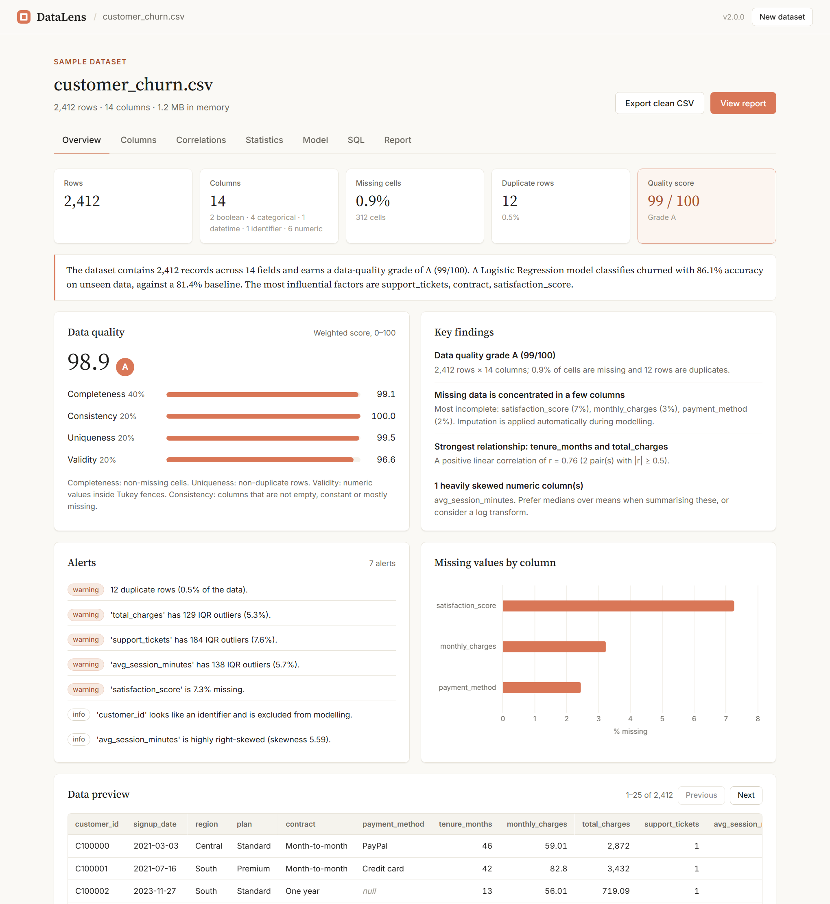
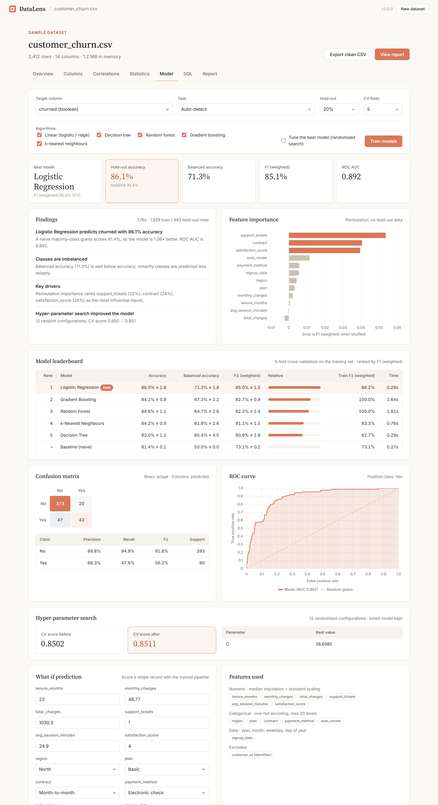
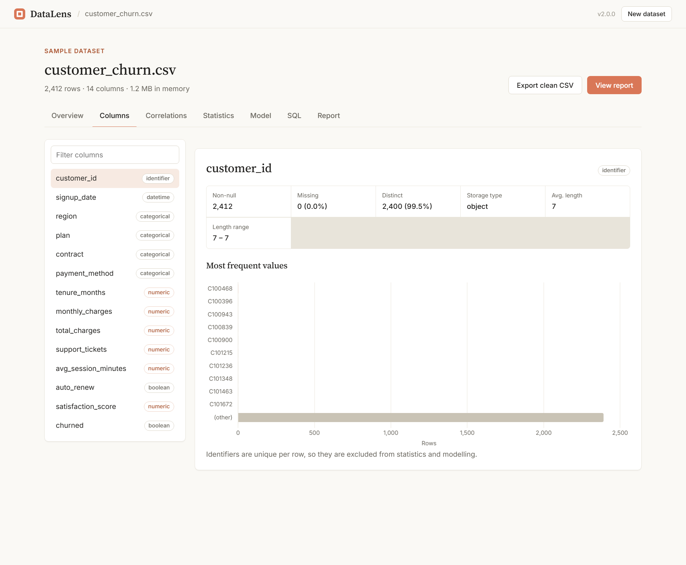
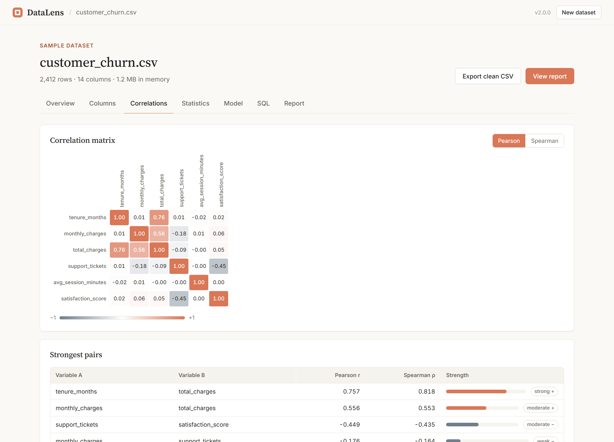
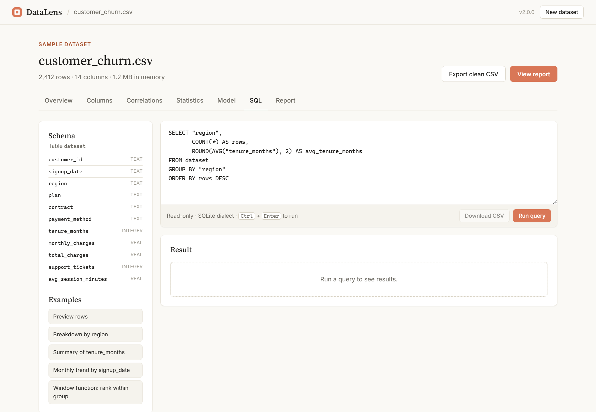

# DataLens: Analytics & AutoML Workbench

DataLens is a web workbench for tabular data. Upload a CSV, Excel, JSON or Parquet file and it will:

1. **Profile** the data: semantic column types, distributions, outliers, missingness, correlations and a weighted data-quality score.
2. **Test** hypotheses: ANOVA, chi-square and correlation tests against a target, with effect sizes and false-discovery-rate correction.
3. **Model** it: five algorithms compared with stratified cross-validation against a naive baseline, optional hyper-parameter search, hold-out evaluation and permutation feature importance.
4. **Query** it with a sandboxed, read-only SQL editor (CTEs and window functions supported).
5. **Report** the results as a print-ready HTML report with an executive summary in plain language.



---

## Highlights

| Area | What it does | Implementation |
|---|---|---|
| Ingestion | Delimiter sniffing, encoding fallback, null-token normalisation, currency/percent/accounting-negative parsing, date detection | `datalens/io.py` |
| Profiling | 8 semantic types (numeric, categorical, boolean, datetime, text, identifier, constant, empty); quantiles, skew, kurtosis, IQR outliers, histograms, monthly timelines | `datalens/profiling.py` |
| Data quality | Score out of 100 from completeness (40%), uniqueness, validity and consistency (20% each), plus prioritised alerts | `datalens/profiling.py` |
| Correlation | Pearson and Spearman matrices, ranked pairs, multicollinearity alerts | `datalens/profiling.py` |
| Statistics | One-way ANOVA (η²), chi-square (Cramér's V), Pearson/Spearman (r); Benjamini–Hochberg adjusted p-values; D'Agostino/Shapiro normality tests | `datalens/stats.py` |
| AutoML | Logistic/Ridge, Decision Tree, Random Forest, Histogram Gradient Boosting, k-NN in leak-free `Pipeline`s (impute → scale/one-hot → date features) | `datalens/modeling.py` |
| Evaluation | Accuracy, balanced accuracy, F1, ROC AUC, ROC curve, confusion matrix, per-class report; R², MAE, RMSE, MAPE, residuals; baseline comparison and overfitting check | `datalens/modeling.py` |
| Explainability | Model-agnostic permutation importance on the original columns; what-if predictions with class probabilities | `datalens/modeling.py` |
| SQL | In-memory SQLite with an authorizer that only allows reads, a single-statement rule, a query timeout and a row limit | `datalens/sql.py` |
| Reporting | Jinja2 HTML report (auto-escaped), plain-language findings, exportable `.joblib` model and cleaned CSV | `datalens/report.py`, `datalens/insights.py` |

## Screenshots

| Model comparison | Column explorer |
|---|---|
|  |  |

| Correlations | SQL workbench |
|---|---|
|  |  |

## Sample results

The three bundled datasets are synthetic, built from realistic business rules plus deliberate missing values, duplicates, outliers and collinear columns (`scripts/generate_samples.py`, fixed seed).

| Dataset | Task | Best model (5-fold CV) | Hold-out result | Naive baseline |
|---|---|---|---|---|
| Customer churn (2,412 × 14) | Classification | Logistic Regression | 86.1% accuracy, ROC AUC 0.89 | 81.4% accuracy |
| House prices (1,800 × 14) | Regression | Gradient Boosting | R² 0.918, MAE ≈ 33.9k | R² 0.00, MAE ≈ 124k |
| Retail orders (3,000 × 13) | Classification | Logistic Regression | 77.5% accuracy, balanced accuracy 66% | 73.2% accuracy |

The statistics tab independently confirms the drivers the models find. For churn, contract type, support tickets and satisfaction score are significant after FDR correction, while region and session length are not.

## Getting started

Requires Python 3.10+.

```bash
python -m venv .venv
.venv\Scripts\activate          # macOS/Linux: source .venv/bin/activate
pip install -r requirements.txt
python app.py
```

Open http://localhost:5000 and pick a sample dataset or upload your own.

### Command line

The same pipeline runs without the UI:

```bash
python -m datalens profile data/samples/house_prices.csv --json profile.json
python -m datalens train data/samples/customer_churn.csv --tune --report churn_report.html --model churn.joblib
```

### Docker

```bash
docker build -t datalens .
docker run -p 8000:8000 datalens
```

## Architecture

```
Browser (static/)                      Flask API (datalens/api.py)
  index.html  ─ tabs, forms              /api/datasets            upload → profile
  js/app.js   ─ views and state   ──►    /api/samples/<key>       load a bundled dataset
  js/charts.js─ Chart.js wrappers         /api/datasets/<id>/rows        paging + sorting
  js/format.js─ pure formatters           /api/datasets/<id>/statistics  hypothesis tests
  js/api.js   ─ fetch client              /api/datasets/<id>/train       AutoML
                                          /api/datasets/<id>/predict     what-if scoring
                                          /api/datasets/<id>/sql         read-only SQL
                                          /api/datasets/<id>/report      HTML report
                                                 │
                     io → profiling → stats / target → modeling → insights → report
                                                 │
                                      DatasetStore (in-memory LRU)
```

Design decisions:

- **No leakage.** All preprocessing lives inside scikit-learn `Pipeline`s, so imputation and scaling are fitted per CV fold. Model selection uses only the training split; the hold-out set is touched once.
- **Every model is compared with a naive baseline.** A model's score only means something next to what always guessing the majority class (or the mean) would get.
- **Permutation importance instead of impurity importance.** It works for every model, is computed on unseen data, and reports importance per original column rather than per one-hot dummy.
- **Statistics before modelling.** Significance and effect size are reported separately, and p-values are FDR-adjusted because many features are tested at once.
- **Safe by default.** Uploads are parsed in memory and never written to disk. SQL runs against a private in-memory copy with an authorizer. Reports are auto-escaped, and the dataset store is bounded.

## Testing

```bash
pip install -r requirements-dev.txt
pytest --cov                 # 94 tests, ~93% line coverage
ruff check . && ruff format --check .
npm test                     # front-end formatter tests (Node 20+, no dependencies)
```

The suite covers parsing edge cases (encodings, delimiters, currency strings, malformed files), semantic typing, outlier and quality maths, statistical results cross-checked against SciPy, BH correction against reference values, end-to-end training for both task types, model export round-trips, SQL sandbox escapes (DROP, ATTACH, PRAGMA, stacked statements, runaway recursive CTEs), every API endpoint including error paths, HTML escaping in reports, and the CLI. GitHub Actions runs lint and tests on Python 3.10 and 3.12, plus the Node tests (`.github/workflows/ci.yml`).

## Project layout

```
datalens/           Python package (analysis engine + Flask API + CLI)
  templates/        Jinja2 report template
static/             Front end (HTML, CSS, ES modules)
data/samples/       Generated demo datasets
scripts/            Sample-data generator
tests/              pytest suite; tests/js for front-end tests
docs/screenshots/   Images used in this README
```

## Configuration

Environment variables (defaults in `datalens/config.py`):

| Variable | Default | Purpose |
|---|---|---|
| `DATALENS_MAX_UPLOAD_MB` | 50 | Upload size limit |
| `DATALENS_MAX_DATASETS` | 8 | Datasets kept in memory (LRU) |
| `DATALENS_MAX_TRAIN_ROWS` | 20000 | Rows sampled for training |
| `DATALENS_SQL_ROW_LIMIT` | 1000 | Maximum rows returned per query |
| `DATALENS_SQL_TIMEOUT_SECONDS` | 5 | SQL execution time limit |

## Limitations

- Datasets live in server memory, so the app runs as a single process and data is lost on restart.
- Training is synchronous; very wide or very large datasets are sampled to keep response times reasonable.
- Statistical tests describe association, not causation.

## Author

**Harshi Singh**

## License

Released under the [MIT License](LICENSE). Copyright (c) 2026 Harshi Singh.

---

<p align="center">Made by Harshi Singh</p>
